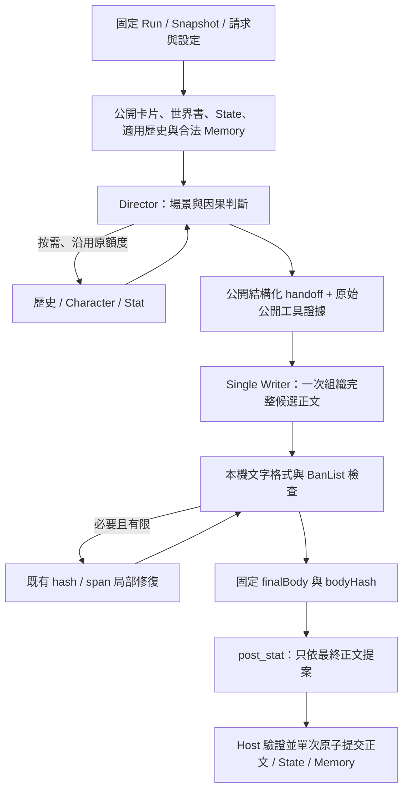

# Single Writer 第一階段候選

這是可選的實驗流程，預設仍為現行模式。來源保留兩批既有修正、角色格式局部重試、獨立文風及原來的兩種寫作方式。本階段沒有自動安裝、推送、發布或修改正式遊玩資料；具體候選 SHA、包雜湊與測試回執由交付包另行固定。

## 啟用與切回

在安裝此候選後，進入 **SCEAN 舞臺 → 設定 → 本局資料 → 寫作方式**，選「單一 Writer（實驗）」並保存。可切回「現行模式」或「素材整理模式（實驗）」。三者共用原來的 Run 設定服務、expectedRevision、票鎖、原子保存及操作 ID，不另建一套 workflow 管理系統。

獨立文風欄繼續可用：舊流程在 Prose 套用，新流程從 Writer 生成正文開始取得。文風只約束表達，不授權改變事實、角色立場、拒絕、玩家決策或裁決結果。模式與文風各自核對版本，保存後下一個新請求生效；生成中與相同 requestId 重試沿用原先固定的設定及方法文字／版本／hash。

取消不保存。缺少或版本不符的方法資源在設定讀取時明示不可用，不能保存該模式，真正生成前也會拒絕；不默默改走另一流程。已開啟頁面不監視檔案變動，可用「放棄模式草稿並重新讀取」確認最新資源狀態。

## 真實資料流

無工具、無修復的普通回合實際呼叫 **Director → writer → post_stat** 三次模型；`validation` 是本機事件，不是評分 Agent。沒有固定 Draft 或 Prose 呼叫，也沒有另一個全文重寫者。

原「現行模式」和「素材整理模式」保持 **Director → Draft → Prose → post_stat**。原材料模式的 Director 同時存在共用 scene intent／observable beats 職責與素材整理方法；這是保留的舊路徑，沒有為新流程暗改它。Single Writer 使用獨立 Director 基礎職責與原創方法，不繼承預寫 beats 的要求，同時保留固定開場、時間終點、角色知識、玩家主體性與裁決邊界。

Director 仍理解行動、場景、因果、狀態、限制及角色立場。它可自主選擇原有四個工具 `search_history`、`read_history`、`consult_character`、`adjudicate_action`，沒有固定關鍵字路由或每輪必問要求。公開 Memory 仍由既有開始前召回供給；Character owner Memory 只在諮詢時依原授權組裝。沒有新增任意 Memory／檔案工具或擴大持續權限。

## 公開交接契約

只在 Single Writer 的 Director 最終回覆要求 `handoffVersion:1` JSON，包含 `sceneIntent` 與五個分組：`knownFacts`、`effectiveConstraints`、`expressedCommitmentsOrRefusals`、`characterPositions`、`unknowns`。各分組最多 24 筆，每筆為 `text` 和 `sourceRefs`；文字最多 1500 字、來源最多 8 個。來源 ID 必須來自當輪提供的 catalog，包括玩家輸入、公開設定、State、歷史、合法公開 Memory 或已完成工具。

Host 驗證結構與來源存在性，標記內容是 Director 的判斷而非新事件。這不是自然語言的事實／語義保密證明。Director 可提出敘事方向與因果判斷，但不預寫台詞、固定角色輪番節拍或不必要停點。只引用 Character Advice 的內容不能被標成已表達的承諾／拒絕。

Host 另從已完成工具記錄建立白名單公開 evidence，不依賴 Director 自由轉述：

| 證據 | 保存的來源與限制 |
|---|---|
| Character | toolCallId、角色、Snapshot、回合、原問題及已投影的 observable／publicUtterances／intendedDisclosures；明示 candidate_not_event |
| Stat | toolCallId、query／calculate／adjudicate、原 action 與原公開回覆；resolution 為 not_structurally_classified，保留原文中的假設與未決限制，不假裝機器已判定成功 |
| 歷史 | 原查詢／locator、原結構化公開參照、Snapshot 與回合；標記是歷史，不是當前事件或全角色共同知識 |

沒有轉交 Character owner packet、withheld、internal、owner Memory、provider trace 或完整工程紀錄。Character 可選擇公開的說法仍受原本結構化公開投影保護；自由文字是否語義上透露秘密，沒有新增模型審查來作保證。

Writer 從一開始取得公開 assembly、適用歷史、合法公開 Memory、角色／卡片、已選公開世界書、公開 State、Director handoff 與 evidence、完整適用 Preset、獨立文風、主角身份、視角／格式規則及完整 `single-writer` 方法。相關欄位已加入 context budget 白名單；Preset 與方法沒有被裁掉。原有完整授權封包策略、16MiB 傳輸安全上限及實際模型容量檢查保持。

## 方法、路由與費用

本階段新增的 `runtime-skills/single-director/SKILL.md`、`runtime-skills/single-writer/SKILL.md` 均為本專案另寫文字，未匯入第三方 preset、Skill、擴展腳本或私人 RP。Host 只從固定模組相對路徑按白名單 hash 載入，按階段送入預檢、實際 Model Port 及 Trace；不是 Agent 自主 toolread。

`single_writer` 沿用原 `writing-mode.json` 設定與 request pin。新模型 stage 名稱為 `writer`、`writer_repair`；它們加入 `RP_MODEL_STAGES`，使用既有 DSH prepared output-default、模型選擇、timeout、cancel、錯誤與 usage 路徑。沒有針對 Gemini、LiteLLM 或某一 provider 新增特殊轉接、改連線設定或偷偷調整參數。

方法完整文字的 bytes／token 估計在原 budget／Trace 中記錄。普通回合少一次正文生成不代表固定費用或品質保證：Director 按需工具、Character 原有有限格式重試及必要 BanList 修復仍可能產生既有額度內的呼叫。沒有補充查證迴圈、品質評分 Agent、盲評或新的固定全文重寫。

## 驗證、狀態與恢復

Writer 候選先通過非空文字、Unicode 結構及既有字面 BanList 檢查。必要時只沿用既有 bodyHash／明確 span 局部修復，最多兩次修復；新路徑在 Trace 中使用 `writer_repair`。這些機械檢查不證明對話好懂、自然或完全語義保真。

修復後才固定 finalBody／bodyHash 並呼叫 post_stat。post_stat 只收到最終正文、前公開 State、角色與原 schema 契約，不收到 brief、Advice 或棄稿。Host 保留原來的 schema、角色、visibility、blueprint、引用驗證與原子 commit；新 Memory 的 source 綁定最終 bodyHash。不存在修復後沿用舊正文 State 提案的路徑。

原來的 Run writer lock、baseVersion／baseHead、canonical receipt 冪等、取消晚到結果、失敗重試與未知提交回執恢復保持。一般 Inspector 新增實際階段摘要；它依已記錄階段顯示，保存了新模式但尚未開始新回合時，仍顯示上一輪真正的舊流程。本機 validation 明示非模型。

## 改檔決策與第二階段邊界

| 模組 | 決策 |
|---|---|
| core/engine.mjs | 在原 Director 工具迴圈之後分支選擇單 Writer；共用原 BanList、post_stat、版本與 commit，不複製第二套 Runtime |
| core/writer-workflow.mjs | 封裝公開 evidence、引用 catalog／handoff 驗證、Writer packet 與 finalBody hash 邊界 |
| core/writing-mode.mjs | 擴充既有模式 enum、固定方法白名單、可用性與相同請求 pin；不新增設定系統 |
| contracts／context-budget／model／save-bundle | 正式加入 stage、授權輸入白名單、原路由與嚴格收據驗證 |
| inspection／共用 player UI | 真實 Writer／局部修復／本機驗證階段、第三個選項、切回與獨立文風 |
| synthetic fixtures／tests | 三次普通生成、工具來源與私密、Preset、修復 hash、原子資料、取消／重試／unknown、舊流程及 UI |

未來補查可接在 Writer 回覆與本機 validation 之間：先定義有限的補查請求協定，再用 `buildWriterHandoff`／`prepareSingleWriterInput` 重建公開證據封包，並跨迴圈保留同一 attempt 的 Director 工具、輪次、Character dispatch、timeout 與取消額度。本階段沒有這個輸出協定、callback、迴圈或新增額度；Writer 工具請求一律拒絕。

本次不實作舊存檔遷移／舊版讀取保證。新版本內可隨時切回舊 workflow，舊正文與 Snapshot 不變；若日後回退程式，先保留完整新版本存檔及來源。包含 Single Writer mode／stage 的收據不保證能由舊版本匯入或匯出；不要把軟體回退當作資料格式遷移。

## 本次可驗證範圍

測試使用隔離合成卡、Run 與 scripted／SDK fixture，沒有正式模型、embedding 或私人 RP 寫入。已驗證無工具普通新回合只有一次主正文生成、既有工具可按需使用、公開來源與 Advice 邊界、完整 Preset、無固定 Prose、局部修復 hash、post_stat final-only、原子 State／Memory、取消、timeout、冪等／未知回執與舊流程。

桌面與窄窗檢查、原始截圖、實際 Port／Trace 比對、完整回歸與平台差異由交付回執列出。Scripted 成功只證明機制，不代表文學品質、所有 provider 或正式端到端通過。真實遊玩品質由使用者於另行安裝後觀察。

乾淨來源以既有白名單匯出並驗證，不包含私人 Git 歷史、Library ID、研究原文或私人 RP。候選包與匹配完整來源 ZIP 保存在本機，沒有公開發布授權。
